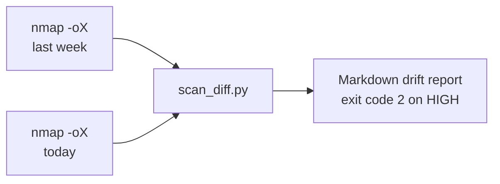

# Nmap Drift Watch

A tiny tool that compares two **Nmap** scans and reports **attack-surface drift**: new hosts, newly opened ports, closed ports and service-version changes. New exposure on risky ports (Telnet, RDP, Redis and similar) is flagged HIGH. It uses only the Python standard library.



## Try it now (no Nmap needed)

```bash
python scan_diff.py sample/baseline.xml sample/current.xml
```

Output for the bundled sample scans (private `192.168.56.x` lab addresses):

```
# Attack Surface Drift Report

**HIGH:** 2  **MEDIUM:** 3  **INFO:** 3

| Severity | Host          | Finding                                                                      |
|----------|---------------|------------------------------------------------------------------------------|
| HIGH     | 192.168.56.10 | Newly open 6379/tcp (redis Redis key-value store 7.0.5) - Redis (often unauthenticated) |
| HIGH     | 192.168.56.50 | Open 23/tcp (telnet) - Telnet (cleartext remote shell)                       |
| MEDIUM   | 192.168.56.10 | Newly open 8080/tcp (http-proxy)                                             |
| MEDIUM   | 192.168.56.50 | New host appeared                                                            |
| MEDIUM   | 192.168.56.50 | Open 80/tcp (http lighttpd 1.4.55)                                           |
| INFO     | 192.168.56.11 | Port 443/tcp closed (https Apache httpd 2.4.52)                              |
| INFO     | 192.168.56.11 | 22/tcp changed: ssh OpenSSH 8.2 -> ssh OpenSSH 9.6                           |
| INFO     | 192.168.56.12 | Host no longer responding                                                    |
```

The tool exits with code **2** when there is any HIGH finding, and **0** otherwise.

## Use it on a real network

```bash
./scripts/scan.sh 192.168.56.0/24            # writes scans/<date>.xml (needs nmap)
python scan_diff.py scans/2026-10-06.xml scans/2026-10-13.xml --out drift.md
```

Run the scan weekly from cron or a scheduled CI job, and alert when the exit code is 2.

## Severity rules

| Severity | When |
|---|---|
| **HIGH** | A host appears with, or an existing host opens, a port from the risky list (FTP, Telnet, SMB, RDP, VNC, MySQL, PostgreSQL, Redis, MongoDB, Elasticsearch, Docker API) |
| **MEDIUM** | A new host appears, or any other port newly opens |
| **INFO** | A host goes quiet, a port closes, or a service version changes |

Edit the `RISKY` dictionary at the top of `scan_diff.py` to match your environment.

## Verification status

- Tested: the diff logic and exit codes against the sample scans (output above), including the no-drift case.
- Not tested: parsing XML from a real Nmap run. The parser reads standard `-oX` output (`host`, `address`, `ports/port`, `service`), but I only tested it on the hand-written sample files.

## Safety

Only scan networks you own or have written permission to scan. The sample files use private lab addresses and describe fictional hosts.
